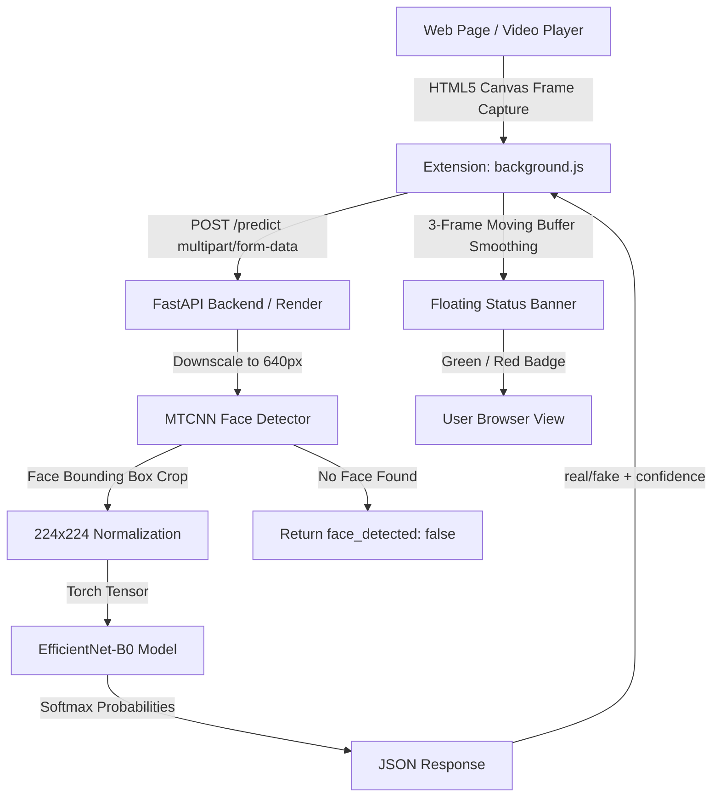

# 🛡️ Browser Deepfake Detector

A real-time deepfake detection platform connecting a lightweight browser extension with an AI inference backend to detect synthetic media, face swaps, and AI-manipulated video/image content directly within web pages.

---

## 🚀 Key Highlights

- 🧠 **Efficient Deep Learning Model**: EfficientNet-B0 backbone fine-tuned on the Deepfake Detection Challenge (DFDC) dataset with **83.81% test accuracy**.
- 👤 **Automated Face Localization**: Built-in **MTCNN** face detection automatically crops and centers facial regions before classification, with automatic image downscaling (640px) to conserve memory.
- ⏱️ **Real-Time Video Stream Monitoring**: Dynamic HTML5 canvas frame extraction polling at 1.5-second intervals with a 3-frame rolling majority-vote smoothing filter to eliminate flicker and reduce false positives.
- ⚡ **Production-Ready FastAPI Backend**: REST API with full CORS support, HEIF/HEIC and standard image format decoding (`pillow_heif`), and containerized deployment with dynamic port binding for Render, Hugging Face Spaces, or local Docker.
- 🎨 **Non-Intrusive Floating HUD**: Real-time on-page badge showing classification verdict (`REAL` vs `FAKE`) and confidence percentage.

---

## 🏗️ System Architecture & Workflow



---

## 📁 Repository Structure

```
Browser-Deepfake-Detector/
├── backend/
│   ├── main.py              # FastAPI server with MTCNN & EfficientNet-B0 inference pipeline
│   ├── model.pt             # Trained PyTorch model weights (~16.3 MB)
│   ├── requirements.txt     # Python backend dependencies (FastAPI, PyTorch, timm, MTCNN, etc.)
│   └── Dockerfile           # Docker container configuration with dynamic PORT support
├── extension/
│   ├── background.js        # Media stream frame polling, Canvas capture & smoothing logic
│   ├── manifest.json        # Extension Manifest configuration
│   ├── popup.html           # Extension popup interface
│   ├── popup.js             # Popup controls and API configuration
│   └── content.js           # Content script for web interaction
├── browser-extension/       # Edge architecture prototype manifest & configuration
├── training/
│   ├── train.py             # Model evaluation and metrics reporting script
│   ├── evaluate.py          # Validation benchmarks
│   └── prepare_data.py      # Dataset loading and preprocessing utilities
├── test/
│   ├── samples_to_test/     # Sample test images (real and synthetic faces)
│   └── samples_to_test.zip  # Archived test samples
└── README.md                # Project documentation
```

---

## ⚡ Quick Start

### 1. Prerequisites
- Python 3.10 or 3.11
- PyTorch & Torchvision
- Docker (optional, for containerized execution)
- Google Chrome, Brave, or Chromium-based browser

### 2. Running the Backend Locally

#### Option A: Native Python Virtual Environment
```bash
# Navigate to backend directory
cd backend

# Create and activate virtual environment
python3 -m venv venv
source venv/bin/activate   # On Windows: venv\Scripts\activate

# Install dependencies
pip install --upgrade pip
pip install -r requirements.txt

# Start the FastAPI server
uvicorn main:app --host 0.0.0.0 --port 8000 --reload
```
The API server will be live at `http://localhost:8000`. You can visit `http://localhost:8000/docs` to inspect interactive Swagger documentation.

#### Option B: Docker Container
```bash
# Build Docker image
docker build -t deepfake-detector-backend ./backend

# Run container (maps host port 8000 to container port 10000)
docker run -p 8000:10000 -e PORT=10000 deepfake-detector-backend
```

---

## 📡 API Specification

### 1. Health Check
- **Endpoint**: `GET /`
- **Response**:
```json
{
  "status": "ok"
}
```

### 2. Predict Face Authenticity
- **Endpoint**: `POST /predict`
- **Request Body**: `multipart/form-data` with form field `file` containing an image file (JPEG, PNG, HEIF/HEIC, WebP).
- **Example `curl` Request**:
```bash
curl -X POST "http://localhost:8000/predict" \
  -H "accept: application/json" \
  -H "Content-Type: multipart/form-data" \
  -F "file=@test/samples_to_test/frxmydygsm.jpg"
```

- **Response (Face Detected)**:
```json
{
  "face_detected": true,
  "prediction": "fake",
  "confidence": 0.9412,
  "fake_probability": 0.9412,
  "real_probability": 0.0588
}
```

- **Response (No Face Detected)**:
```json
{
  "face_detected": false,
  "prediction": null,
  "confidence": null,
  "fake_probability": null,
  "real_probability": null
}
```

---

## 🧩 Browser Extension Setup & Usage

1. Open Chrome or any Chromium-based browser and navigate to `chrome://extensions`.
2. Enable **Developer mode** using the toggle in the top right corner.
3. Click **Load unpacked** and select the `extension/` directory.
4. **Triggering Real-Time Monitoring**:
   - The monitoring logic in `background.js` targets HTML5 `<video>` tags on the active page (e.g. YouTube, web video feeds, or video calls).
   - In the Developer Tools console (or injected script), call:
     ```javascript
     toggleMonitoring("http://localhost:8000/predict");
     ```
   - A floating status HUD appears in the top-right corner of the page:
     - 🟢 **REAL**: Authentic face detected with smoothed confidence score.
     - 🔴 **FAKE**: Synthetic / manipulated face detected with smoothed confidence score.
     - ⚪ **GRAY**: Searching for active video stream or waiting for detectable face.

---

## 📊 Model Training & Benchmarks

The detection model leverages transfer learning based on the **EfficientNet-B0** architecture:
- **Pretrained Backbone**: EfficientNet-B0 via `timm`, modified with a 2-class linear classification head.
- **Dataset**: Deepfake Detection Challenge (DFDC) dataset containing balanced authentic and deepfake manipulated videos.
- **Preprocessing Pipeline**:
  1. Frames downscaled to 640px to bound memory consumption.
  2. MTCNN extracts and crops detected facial bounding boxes.
  3. Image tensor resized to 224x224 and normalized with standard ImageNet mean (`[0.485, 0.456, 0.406]`) and standard deviation (`[0.229, 0.224, 0.225]`).
- **Benchmark Performance**: **83.81% Test Accuracy** with precision and recall evaluated in `training/train.py`.

---

## 🛑 Version Control Rules
* **DO NOT** commit raw image/video datasets to Git (keep them in `data/` or external cloud storage).
* **DO NOT** commit temporary or heavy checkpoint `.pt` weights outside of finalized model files.

---

## 🗺️ Future Roadmap
- [ ] Export trained PyTorch weights to quantized ONNX (INT8 / FP16).
- [ ] Client-side in-browser inference using ONNX Runtime Web (`onnxruntime-web`) and WebGPU.
- [ ] Audio stream frequency analysis (Mel-spectrogram CNN for synthetic voice detection).
- [ ] Context-menu integration for right-click image scanning.